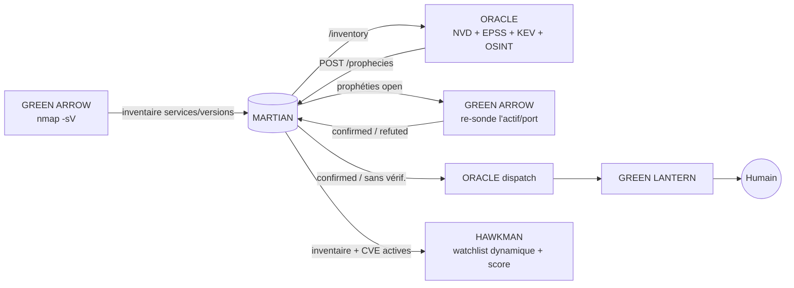

# 11. Prophéties : la boucle ORACLE → GREEN ARROW / HAWKMAN / GREEN LANTERN

Jusqu'ici, chaque agent écrivait dans MARTIAN et personne n'agissait sur ce que les autres avaient appris. Les **prophéties** ferment la boucle : ORACLE anticipe, GREEN ARROW vérifie, HAWKMAN priorise, GREEN LANTERN prévient, MARTIAN garde la trace et le résultat.



## Ce qu'est une prophétie

`« CVE-X sera probablement exploitée sur l'actif Y avant la date D »`, avec sa base de calcul (table `prophecies`) :

| Champ | Sens |
|---|---|
| `probability` | 0–1. **EPSS** (FIRST) ; relevé à **0,95** si la CVE est dans la **CISA KEV** (exploitation avérée). Jamais produite par le LLM |
| `priority` | 0–100 = `100 × probability × criticité de l'actif` |
| `basis` | `model` (EPSS/KEV) ou `rule` (règle déterministe OSINT : ce n'est alors **pas** une probabilité) |
| `deadline` | échéance KEV de la CISA, sinon +7 j (P ≥ 0,5) ou +30 j |
| `status` | `open` → `confirmed` / `refuted` → `notified` → `acknowledged` ; `resolved` quand le risque disparaît |
| `evidence` | historique horodaté de qui a fait quoi (GREEN ARROW, GREEN LANTERN…) |

## Qui fait quoi

**GREEN ARROW** (`inventory.py`) : découverte puis `nmap -sV --version-light` (top `SERVICE_TOP_PORTS` ports) **sur `AUTHORIZED_CIDRS` uniquement**, publié comme entité `asset_services`. Pour chaque prophétie `open`, il re-sonde *seulement* l'actif et le port visés : service identique → `confirmed` ; port explicitement `closed` ou autre version → `refuted` ; `filtered`, hôte injoignable ou version non identifiée → **non concluant** (rien n'est modifié). Au plus `PROPHECY_VERIFY_BATCH` re-sondes par minute, une par prophétie et par `PROPHECY_VERIFY_COOLDOWN`.

**ORACLE** (`prophet.py`) : toutes les `PROPHET_INTERVAL` s, convertit les CPE de nmap en CPE 2.3, interroge NVD (`cpeName`, cache 24 h), EPSS et KEV, publie les prophéties, et **résout** celles dont le risque a disparu (actif réinventorié, sans erreur NVD). Il publie aussi des prophéties « règle » tirées de l'OSINT : certificat TLS ≤ 30 j, DMARC absent/`p=none`, SPF absent. Toutes les 60 s, il prévient GREEN LANTERN : tout de suite pour une prophétie `confirmed` (≥ `PROPHET_NOTIFY_MIN`), après `PROPHET_VERIFY_TIMEOUT_H` heures pour une prophétie non vérifiable (hors périmètre de scan), tout de suite pour l'OSINT.

**HAWKMAN** : toutes les `WATCH_EXPOSURE_INTERVAL` s, sa **watchlist devient dynamique** (produits réellement trouvés par GREEN ARROW, ex. `openssh`, `nginx`) et le score des éléments dont une CVE fait l'objet d'une prophétie active est **rehaussé de `WATCH_PROPHECY_BOOST`** (une seule fois). Les alertes portent la mention « ⚠ EXPOSÉ ».

**GREEN LANTERN** : reçoit le message, avec sévérité `critical` (≥ 90), `high` (≥ 70) ou `medium`.

## Autonomie : ce qui est automatique et ce qui ne l'est pas

Tout ce qui est **automatique est passif ou en lecture seule** : relevé de versions, calcul de risque, re-vérification ciblée, rescoring, notification. **Aucune remédiation n'est exécutée** (patch, blocage, isolement) : c'est le principe « l'IA propose, l'humain décide » de [Sécurité](08-securite.md). Garde-fous :

- périmètre : `AUTHORIZED_CIDRS` vide = inventaire et vérification **désactivés** ; chaque re-sonde revalide que l'IP est une IPv4 du périmètre ; aucune commande passée par un shell ;
- pas de CPE ⇒ pas de prophétie (on préfère rater un cas que fabriquer un faux positif) ;
- en cas de panne NVD, rien n'est marqué `resolved` ;
- le LLM n'intervient pas dans le calcul des probabilités.

## API (MARTIAN, jeton `X-AI-Gateway-Token`)

| Méthode | Chemin | Rôle |
|---|---|---|
| `POST` | `/prophecies` | crée/rafraîchit (idempotent sur `key`) ; rouvre une prophétie `resolved`/`refuted` qui réapparaît |
| `GET` | `/prophecies?status=open,confirmed&kind=cve&asset=&min_priority=&limit=` | liste (triée par priorité) |
| `PATCH` | `/prophecies/{id}` | `{"status": "...", "mark_notified": bool, "evidence": {...}}` — l'évidence s'ajoute, ne remplace jamais |
| `GET` | `/inventory` | inventaire services/versions par actif |

Prendre acte d'une prophétie (pour la sortir des relances) :

```bash
docker exec justice-league-soc python -c "import urllib.request as u,json,os;r=u.Request('http://martian-core:8787/prophecies/ID',method='PATCH',data=json.dumps({'status':'acknowledged'}).encode(),headers={'Content-Type':'application/json','X-AI-Gateway-Token':os.environ['AI_GATEWAY_TOKEN']});print(u.urlopen(r).read())"
```

## Configuration

Variables dans `config/config.env` (voir `config.env.example`) : `PROPHET_*`, `ASSET_CRITICALITY` (JSON, ex. `'{"192.168.1.10":2.0}'`), `SERVICE_SCAN`, `SERVICE_TOP_PORTS`, `PROPHECY_VERIFY*`, `WATCH_EXPOSURE_INTERVAL`, `WATCH_PROPHECY_BOOST`, `NVD_API_KEY` (recommandée : sans clé, NVD limite à 5 requêtes / 30 s et le premier cycle est lent).

## Limites connues

- La correspondance CVE ↔ service dépend du **CPE détecté par nmap** : un service dont la version n'est pas identifiée n'est pas couvert.
- Les CVE sont retrouvées par le CPE exact du service ; les corrections rétroportées par les distributions (Debian, Ubuntu…) ne changent pas le numéro de version : une prophétie peut alors être un faux positif. La vérification de GREEN ARROW ne le détecte pas (même version) ; l'humain tranche (`acknowledged`).
- EPSS mesure la probabilité d'exploitation dans la nature, pas l'impact sur votre environnement : d'où la criticité d'actif (`ASSET_CRITICALITY`).
- Sous Docker Desktop (macOS), GREEN ARROW ne voit pas le LAN de l'hôte (voir [Dépannage](09-depannage.md)) : l'inventaire restera vide tant qu'il n'a pas accès au réseau à scanner.
